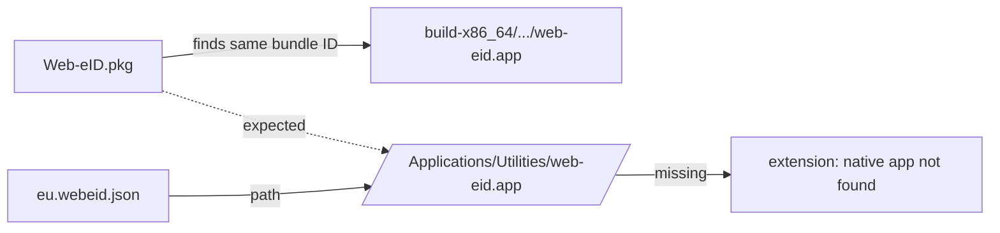

# macOS installer: bundle relocation into a local build tree

## Symptom

After installing the release `Web-eID.pkg` (2.11.0, universal, notarized), the
browser extension could not start the native app. The pkg receipt
(`pkgutil --files eu.web-eid.web-eid`) listed `Applications/Utilities/web-eid.app`,
but the directory did not exist.

## Cause

macOS Installer treats app bundles as *relocatable* by default. Before installing,
it searches the disk for a bundle with the same identifier (`eu.web-eid.web-eid`)
and, if it finds one, "upgrades" that copy in place instead of installing to the
payload path. Here it found a local build at
`build-x86_64/src/app/web-eid.app` and installed the release bundle there.

`/var/log/install.log` shows it plainly:

```
PackageKit: Applications/Utilities/web-eid.app relocated to
  Users/ms/git/stepanic/web-eid-app/build-x86_64/src/app/web-eid.app
```

The native messaging manifests (`/Library/Google/Chrome/NativeMessagingHosts/eu.webeid.json`,
the Firefox equivalent) hard-code `/Applications/Utilities/web-eid.app/Contents/MacOS/web-eid`,
so the browser had nothing to launch.



This only hits machines that have a local build of the app (developers). Ordinary
users are unaffected, which is why upstream has not noticed.

## Fix

`5131a8d` — `src/app/CMakeLists.txt`, target `installer-native`:

```
pkgbuild --analyze --root root_native native-component.plist
plutil -replace 0.BundleIsRelocatable -bool NO native-component.plist
pkgbuild --root root_native --component-plist native-component.plist ...
```

Generating the plist with `--analyze` (rather than committing a static one) keeps
the Qt child-framework entries in sync with whatever `macdeployqt` produced.

## Recovering an already-affected install

Move the relocated bundle to its proper place and remove the build tree:

```
sudo mv <build-dir>/src/app/web-eid.app /Applications/Utilities/
rm -rf <build-dir>
```

The relocated bundle is the signed release bundle, so no reinstall is needed.
Verified 2026-11-04: `codesign --verify --deep --strict` OK, `spctl` reports
"Notarized Developer ID", archs `x86_64 arm64`.

## Open

- The fix is not yet in a release build. The first DMG built after `5131a8d`
  should be checked: install it with a local build present and confirm
  `install.log` has no "relocated to" line.
- Candidate for an upstream PR to web-eid/web-eid-app.
